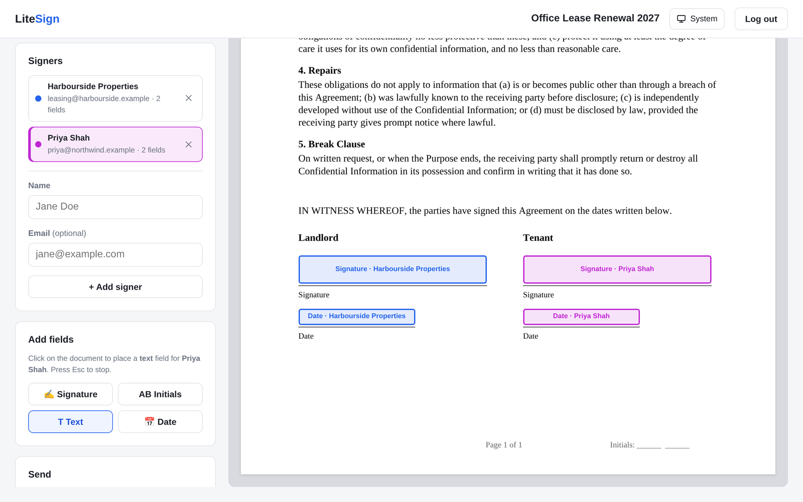
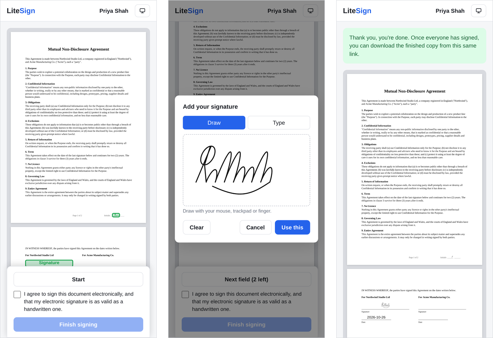
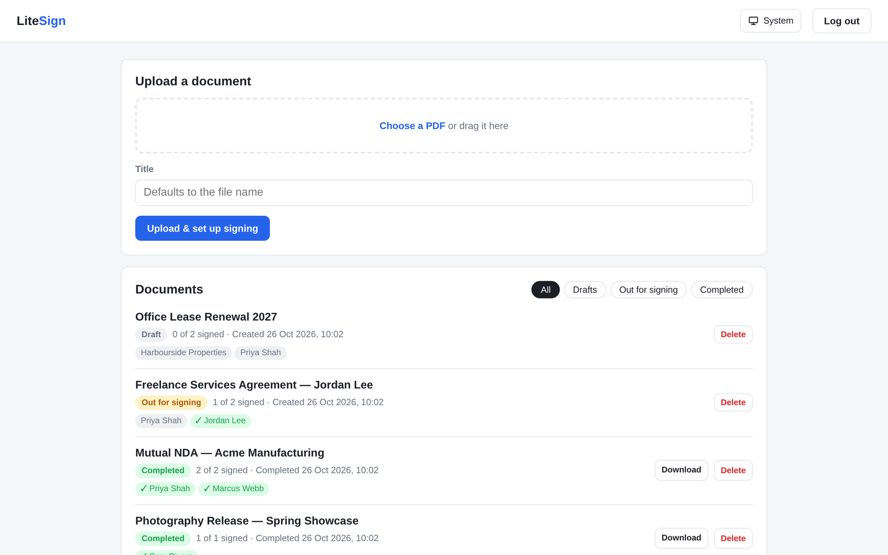
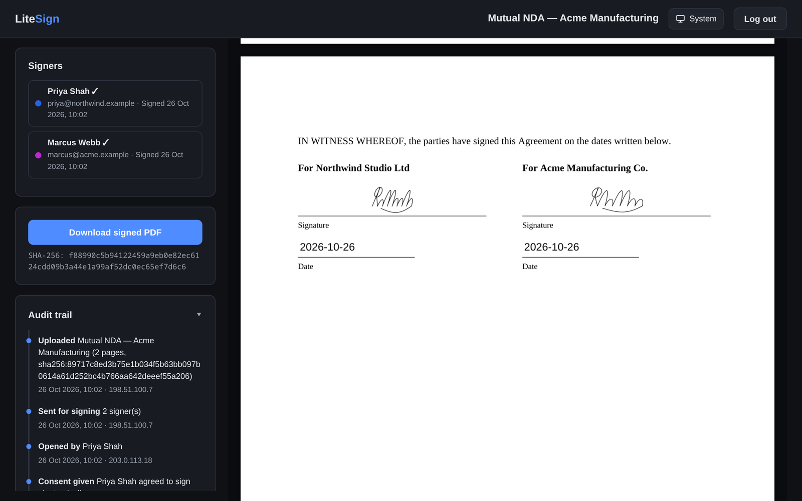
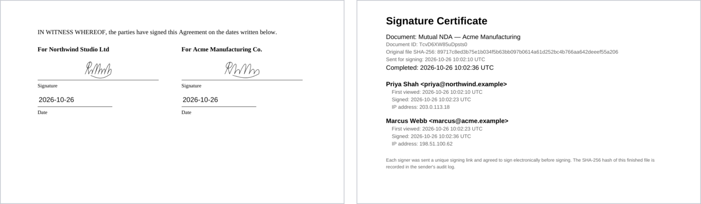

#  LiteSign

**Self-hosted document signing that actually stays lightweight.** Upload a
PDF, drop signature fields on it, and send it to people outside your
organisation to sign in their browser. One container, one SQLite file, your
own SMTP. No accounts for signers, no per-envelope pricing, no paid tier.



## Features

**For you, the sender**
- Upload a PDF and add as many signers as you need, each with their own colour.
- Click to place **signature**, **initials**, **text** and **date** fields; drag to
  move, drag the corner to resize, double-click a text field to label it
  ("Company name", "Job title"…).
- Send with one click. LiteSign emails each signer a private link, or, if
  you haven't set up SMTP, gives you the links to send yourself.
- Track progress: who has opened their link, who has signed, and a full
  audit trail with timestamps and IP addresses.
- Copy a link or resend an email at any time, or cancel a request if you
  sent the wrong version (its links stop working immediately).

**For your signers**
- No account, no app: the link opens straight to the document.
- Works properly on phones: pages fit the screen and a "Next field" button
  walks them through every field.
- Draw a signature with a finger, mouse or trackpad, or type it.
- They agree to sign electronically, submit, and can download the
  finished copy from the same link.

**For the record**
- When everyone has signed, LiteSign stamps every value into the PDF and
  appends a **signature certificate**: each signer's name, email, when they
  first opened the document, when they signed, and from what IP, plus the
  SHA-256 of the original file.
- Every signer is emailed the completed PDF, and its SHA-256 is kept in the
  audit trail so you can later prove the file hasn't changed.

**Everywhere**
- Light and dark themes that follow the device's setting, with a
  System / Light / Dark toggle on every page.

## Screenshots

<table>
<tr><td colspan="2">

**Signing on a phone:** guided field-by-field, draw or type a signature, done.



</td></tr>
<tr><td width="50%">

**Dashboard**

<picture>
  <source media="(prefers-color-scheme: dark)" srcset="docs/screenshots/dashboard-dark.png">
  
</picture>

</td><td width="50%">

**Completed document** (dark mode)



</td></tr>
<tr><td colspan="2">

**The finished PDF:** values stamped in place, with a signature certificate appended.



</td></tr>
</table>

## Quick start

You need Docker with Compose.

```bash
git clone https://github.com/Imdabossou/LiteSign.git
cd LiteSign
cp .env.example .env
# Edit .env: set ADMIN_PASSWORD (required), BASE_URL, and your SMTP details
docker compose up -d --build
```

Open <http://localhost:8080>, log in with your `ADMIN_PASSWORD`, and upload
a PDF. SMTP is optional: without it everything works, and you send the
signing links yourself.

<details>
<summary>Plain <code>docker run</code> instead of Compose</summary>

```bash
docker build -t litesign .
docker run -d \
  --name litesign \
  -p 8080:8080 \
  -e ADMIN_PASSWORD='a-long-random-password' \
  -e BASE_URL=https://sign.example.com \
  -e SMTP_HOST=smtp.example.com \
  -e SMTP_PORT=587 \
  -e SMTP_USER=you@example.com \
  -e SMTP_PASS='your-smtp-password' \
  -e SMTP_FROM=you@example.com \
  -v litesign_data:/app/data \
  litesign
```

</details>

## Configuration

All configuration is through environment variables (or `.env` with Compose).

| Variable         | Default      | What it does |
|------------------|--------------|--------------|
| `ADMIN_PASSWORD` | *(required)* | Password for the single admin login. The app won't start without one, or with `changeme`. |
| `BASE_URL`       | *(unset)*    | Public URL, e.g. `https://sign.example.com`. Used to build signing links; an `https://` URL also turns on secure cookies. |
| `SMTP_HOST`      | *(unset)*    | SMTP server. Leave unset to send links yourself. Works with Gmail (app password), SendGrid, Mailgun, SES, Postmark, your own server… |
| `SMTP_PORT`      | `587`        | 587/25 use STARTTLS automatically; 465 uses implicit TLS. |
| `SMTP_SECURE`    | `false`      | Set `true` to force implicit TLS (automatic on port 465). |
| `SMTP_USER`      | *(unset)*    | SMTP username, if your provider needs one. |
| `SMTP_PASS`      | *(unset)*    | SMTP password, app password or API key. |
| `SMTP_FROM`      | `SMTP_USER`  | From address on outgoing emails. |
| `APP_NAME`       | `LiteSign`   | Name shown in emails ("Sent via …"). |
| `TRUST_PROXY`    | `1`          | Reverse-proxy hops in front of the app. Needed for correct signer IPs and secure cookies. Set `0` if nothing is in front of it. |
| `MAX_UPLOAD_MB`  | `25`         | Largest PDF you can upload. |
| `SESSION_SECRET` | generated    | Cookie signing secret. Generated once and stored in the database if unset. |
| `PORT`           | `8080`       | Port the app listens on inside the container. |
| `DATA_DIR`       | `/app/data`  | Where the database and PDFs live. |

## Putting it on the internet

LiteSign is designed to be reachable by people outside your network, but it
speaks plain HTTP, so put a reverse proxy with TLS in front of it. Caddy
gets you automatic HTTPS in three lines:

```
sign.example.com {
  reverse_proxy litesign:8080
}
```

Then set `BASE_URL=https://sign.example.com`. nginx, Traefik and
Cloudflare Tunnel work just as well; keep `TRUST_PROXY` matched to the
number of proxies in front of the app.

Built in for internet-facing use:

- Rate limiting on login and on the public signing endpoints.
- A strict Content-Security-Policy and the usual security headers (via
  `helmet`). Every script is served by the app itself: no inline scripts,
  no CDNs, no third-party requests from your signers' browsers.
- Cross-origin request blocking on the API, SameSite cookies, and a fresh
  session on every login.
- Strict validation of uploads, field positions and submitted signatures.

## Backups

Everything lives in the `/app/data` volume:

- `litesign.sqlite`: documents, signers, fields, audit trail and sessions
- `files/`: the uploaded originals and the completed, signed PDFs

```bash
docker run --rm -v litesign_data:/data -v "$(pwd)":/backup alpine \
  tar czf /backup/litesign-backup.tar.gz /data
```

Upgrading is `git pull && docker compose up -d --build`. The database
upgrades itself on start-up.

## Security model

- **One admin.** LiteSign is for an individual or team sending documents
  out, not a multi-tenant service. There is a single admin password.
- **The link is the key.** Each signer gets a link containing a random
  192-bit token; whoever has the link can sign as that signer, so email
  delivery is the access control (the same model as DocuSign and friends).
  Links only work once a document is sent, and stop working if you cancel it.
- **Health check.** `GET /healthz` returns `{"ok":true}` and is used by the
  Docker health check.

## Is it legally binding?

LiteSign captures what most e-signature tools capture: each signer's drawn
or typed signature, their explicit consent to sign electronically,
timestamps, IP addresses, an audit trail, and hashes of the original and
final files. That is enough for most everyday business agreements in many
places, but it hasn't been assessed against specific regimes such as
eIDAS or ESIGN, and it isn't a "qualified" or certificate-based digital
signature. If a document needs to stand up in court or in a regulated
industry, check with a lawyer first.

## Development

```bash
npm install
ADMIN_PASSWORD=dev-password-123 BASE_URL=http://localhost:8080 npm start
npm test   # end-to-end API tests against a throwaway data directory
```

Requires Node.js 22 or newer. There is no frontend build step: plain HTML,
CSS and ES modules in `public/`, with the server in `server/`.

**Stack:** Node.js and Express 5, `better-sqlite3`, `pdf-lib` (stamping
PDFs), `pdfjs-dist` (rendering in the browser), `nodemailer`, `multer`,
`helmet` and `express-rate-limit`.

## Licence

LiteSign is free software under the [GNU Affero General Public License v3.0 or later](LICENSE) (AGPL-3.0-or-later).
You can use, change and share it, including commercially. If you share a changed version, or run one as a service
that other people use over a network, you must make its source code available under the same licence.
