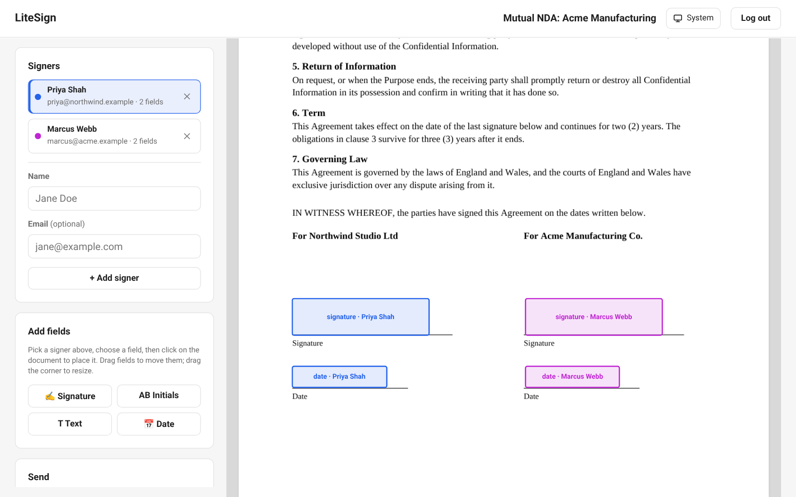
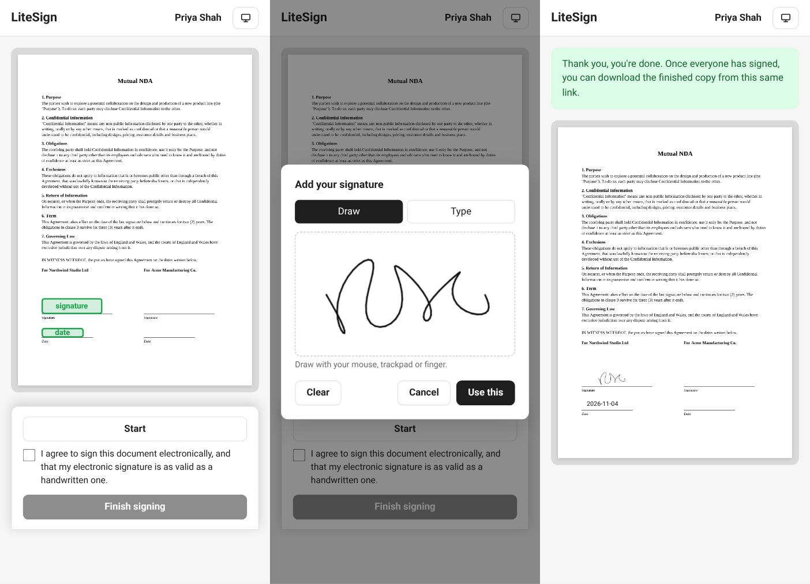

#  LiteSign

**Self-hosted document signing that stays lightweight.**

Upload a PDF, drop signature fields on it, and send it to anyone to sign in their browser. One container, one SQLite file, your own email. No accounts for signers, no per-document fees, no paid tier.



## Features

- **Place fields in seconds**: signature, initials, text and date, for as many signers as you need
- **Send with one click**: each signer gets a private link by email, or copy the links yourself
- **Easy for signers**: no account or app, works on phones, draw or type a signature
- **Track everything**: who has opened, who has signed, and a full audit trail
- **A signed PDF with a certificate**: every value stamped in, plus names, times, IP addresses and file hashes
- **Built for the internet**: rate limiting, strict security headers, and no third-party scripts
- **Light and dark themes** that follow your device



## Install

You need Docker with Compose.

```sh
git clone https://github.com/Imdabossou/LiteSign.git
cd LiteSign
cp .env.example .env   # set ADMIN_PASSWORD, BASE_URL and your SMTP details
docker compose up -d --build
```

Open <http://localhost:8080> and log in with your `ADMIN_PASSWORD`. Email is optional: without it, you send the signing links yourself.

The [admin guide](docs/guide.md) covers every setting, putting LiteSign on the internet, backups, and whether signatures are legally binding.

## Licence

Free and open source under the [GNU AGPL v3 or later](LICENSE). Want to work on it? See [BUILDING.md](BUILDING.md).
