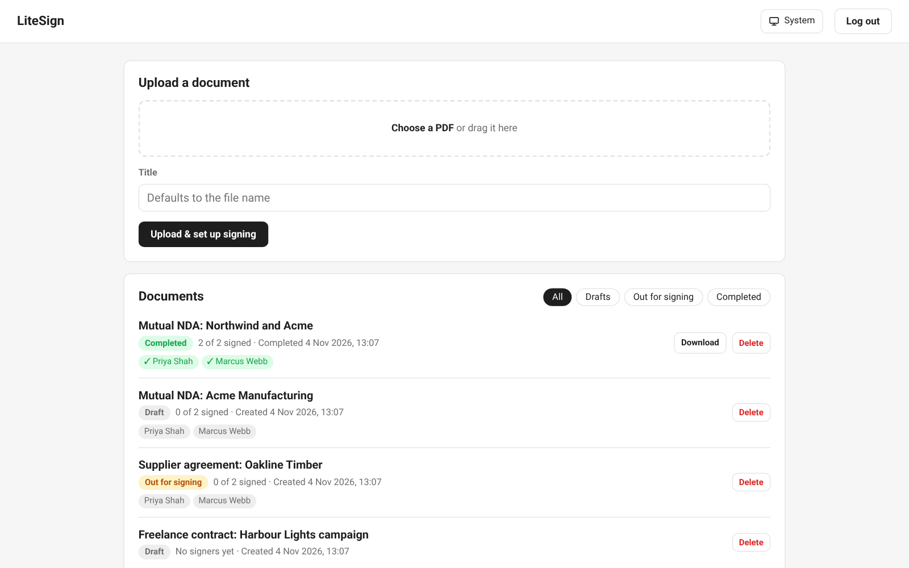
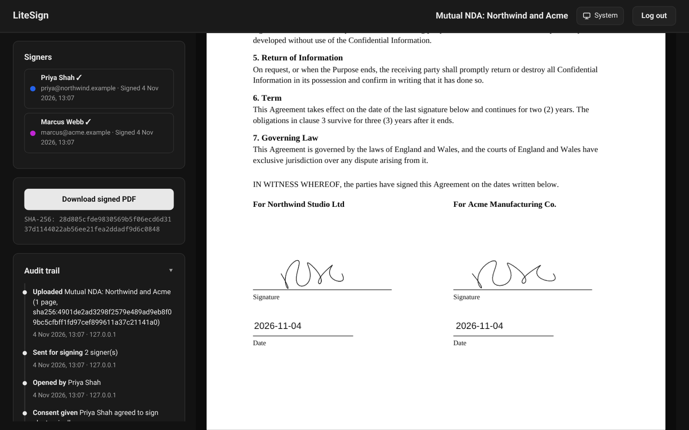
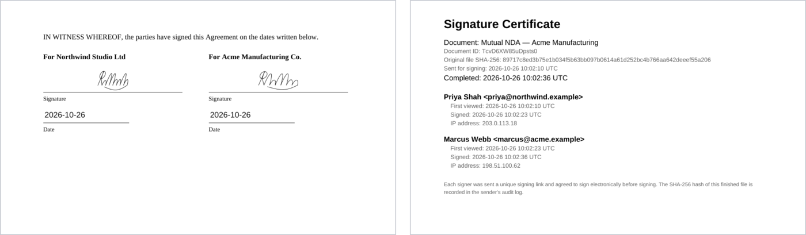

# Running LiteSign

## Configuration

All configuration is through environment variables (or `.env` with Compose).

| Variable         | Default      | What it does |
|------------------|--------------|--------------|
| `ADMIN_PASSWORD` | *(required)* | Password for the single admin login. The app won't start without one, or with `changeme`. |
| `BASE_URL`       | *(unset)*    | Public URL, e.g. `https://sign.example.com`. Used to build signing links; an `https://` URL also turns on secure cookies. |
| `SMTP_HOST`      | *(unset)*    | SMTP server. Leave unset to send links yourself. Works with Gmail (app password), SendGrid, Mailgun, SES, Postmark, your own server… |
| `SMTP_PORT`      | `587`        | 587/25 use STARTTLS automatically; 465 uses implicit TLS. |
| `SMTP_SECURE`    | `false`      | Set `true` to force implicit TLS (automatic on port 465). |
| `SMTP_USER`      | *(unset)*    | SMTP username, if your provider needs one. |
| `SMTP_PASS`      | *(unset)*    | SMTP password, app password or API key. |
| `SMTP_FROM`      | `SMTP_USER`  | From address on outgoing emails. |
| `APP_NAME`       | `LiteSign`   | Name shown in emails ("Sent via …"). |
| `TRUST_PROXY`    | `1`          | Reverse-proxy hops in front of the app. Needed for correct signer IPs and secure cookies. Set `0` if nothing is in front of it. |
| `MAX_UPLOAD_MB`  | `25`         | Largest PDF you can upload. |
| `SESSION_SECRET` | generated    | Cookie signing secret. Generated once and stored in the database if unset. |
| `PORT`           | `8080`       | Port the app listens on inside the container. |
| `DATA_DIR`       | `/app/data`  | Where the database and PDFs live. |

<details>
<summary>Plain <code>docker run</code> instead of Compose</summary>

```bash
docker build -t litesign .
docker run -d \
  --name litesign \
  -p 8080:8080 \
  -e ADMIN_PASSWORD='a-long-random-password' \
  -e BASE_URL=https://sign.example.com \
  -e SMTP_HOST=smtp.example.com \
  -e SMTP_PORT=587 \
  -e SMTP_USER=you@example.com \
  -e SMTP_PASS='your-smtp-password' \
  -e SMTP_FROM=you@example.com \
  -v litesign_data:/app/data \
  litesign
```

</details>

## Sending documents

<p>
  <picture><source media="(prefers-color-scheme: dark)" srcset="screenshots/dashboard-dark.png"></picture>
  
</p>

- Add your signers (each gets their own colour), then click to place **signature**, **initials**, **text** and **date** fields. Drag to move, drag the corner to resize, and double-click a text field to label it ("Company name", "Job title"…).
- Copy a link or resend an email at any time. Cancelling a request stops its links working immediately, which is useful if you sent the wrong version.
- Signers agree to sign electronically, a "Next field" button walks them through every field, and they can download the finished copy from the same link.
- When everyone has signed, LiteSign stamps every value into the PDF and appends a **signature certificate**: each signer's name, email, when they first opened the document, when they signed, and from what IP, plus the SHA-256 of the original file. Every signer is emailed the completed PDF, and its SHA-256 is kept in the audit trail so you can later prove the file hasn't changed.



## Putting it on the internet

LiteSign is designed to be reachable by people outside your network, but it speaks plain HTTP, so put a reverse proxy with TLS in front of it. Caddy gets you automatic HTTPS in three lines:

```
sign.example.com {
  reverse_proxy litesign:8080
}
```

Then set `BASE_URL=https://sign.example.com`. nginx, Traefik and Cloudflare Tunnel work just as well; keep `TRUST_PROXY` matched to the number of proxies in front of the app.

Built in for internet-facing use:

- Rate limiting on login and on the public signing endpoints.
- A strict Content-Security-Policy and the usual security headers (via `helmet`). Every script is served by the app itself: no inline scripts, no CDNs, no third-party requests from your signers' browsers.
- Cross-origin request blocking on the API, SameSite cookies, and a fresh session on every login.
- Strict validation of uploads, field positions and submitted signatures.

## Backups and upgrades

Everything lives in the `/app/data` volume:

- `litesign.sqlite`: documents, signers, fields, audit trail and sessions
- `files/`: the uploaded originals and the completed, signed PDFs

```bash
docker run --rm -v litesign_data:/data -v "$(pwd)":/backup alpine \
  tar czf /backup/litesign-backup.tar.gz /data
```

Upgrading is `git pull && docker compose up -d --build`. The database upgrades itself on start-up.

## Security model

- **One admin.** LiteSign is for an individual or team sending documents out, not a multi-tenant service. There is a single admin password.
- **The link is the key.** Each signer gets a link containing a random 192-bit token; whoever has the link can sign as that signer, so email delivery is the access control (the same model as the big e-signature services). Links only work once a document is sent, and stop working if you cancel it.
- **Health check.** `GET /healthz` returns `{"ok":true}` and is used by the Docker health check.

## Is it legally binding?

LiteSign captures what most e-signature tools capture: each signer's drawn or typed signature, their explicit consent to sign electronically, timestamps, IP addresses, an audit trail, and hashes of the original and final files. That is enough for most everyday business agreements in many places, but it hasn't been assessed against specific regimes such as eIDAS or ESIGN, and it isn't a "qualified" or certificate-based digital signature. If a document needs to stand up in court or in a regulated industry, check with a lawyer first.
